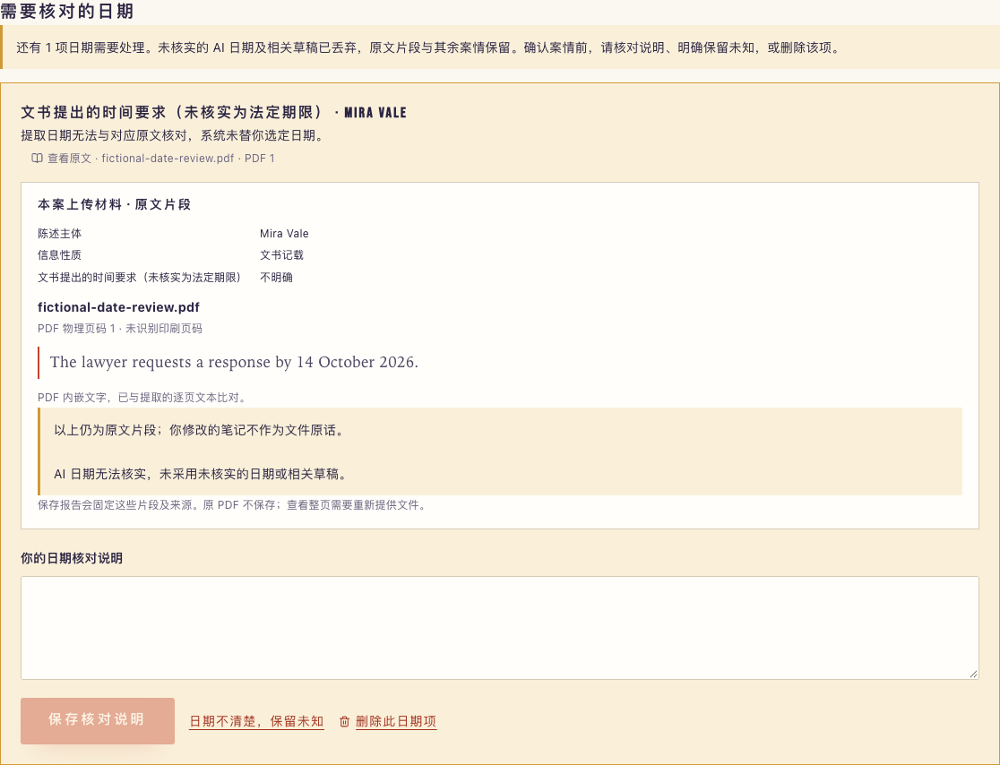

# PDF 日期校验与人工核对修复（2026-10-09）

## 本次故障

用户截屏提示“第 9 项：AI 提取的日期与所引原文不一致”。生产诊断确认 `date_mismatch`，案件索引 0、提取项索引 8。它与此前超时不同：模型已经返回，但日期校验拦下了整批结果。

应用不保存用户 PDF 或模型草稿，日志只包含请求编号、允许列表原因和数字位置。因此没有取得该文件的实际日期，不能断言它只是格式差异，也不能断言是模型编造；本次修复覆盖这两种情况，没有再次付费处理用户文件。

## 修复行为

- 完整、无歧义的公历日期支持中文年月日、年在前的 ISO 日期和英文月份日期之间核对。校验后保存引用中的实际连续日期文字；不生成冒充原文的新日期。日期有效性包含闰年检查，避免将 13 日的后半段当作 3 日。
- 格式转换遇到多日期、否定、相对时间、范围或其他历法时保守交给人工；不推算缺失年月日，也不猜测斜线日期的日月顺序。
- 日期不符或缺失只影响对应项。撤回该项 AI 日期与相关草稿，保留已核对的原文片段和其他案情；冲突关系仍保留，需要核对的日期不会进入事实预填。
- 核对页每轮最多展示 3 项。用户可填写核对说明、明确保留未知或删除；多项可一次保留未知。未处理项不能绕过最终确认，普通编辑也不能自动消除日期问题。
- 用户说明与文件引文分别保留；人工处理后结构化 `date` 仍为 `null`，说明不会变成“独立核实日期”。报告快照和导出保留实际核对状态；后续编辑不修改历史快照。
- 本次目标、接收人和披露范围仍由用户确认。原有领域判断、手动录入、规则参考和隐私策略沿用。
- 新增材料协议版本 2。旧页面在调用模型前得到 409 和刷新提示，避免旧的严格响应校验器丢弃新版结果；旧页面的非 AI 文字提取仍可用。

未放宽文件、页码和引文核对，不引入模糊文字匹配、不换模型、不自动重试。PDF 仍在浏览器和请求内存临时处理，不添加文件库或共享缓存；保存报告仅保存片段、来源和快照，不保存 PDF。

## 代码与本地验证

- 公共核对状态与确认边界：`3b51cc2`。
- 核对页面与浏览器用例：`90efe8d`，独立 UI agent。
- 日期文字匹配与 72 个定向用例：`b42c82d`，独立服务端 agent。
- 服务端接入、报告导出与旧页面保护：`9657313`。
- 全量 30 个测试文件：439 通过、2 个既有 provider 录制样本测试跳过。
- TypeScript 与 Next 生产构建通过。
- 本地 PDF 流程浏览器 13 项通过；最后新增协议请求头后，日期核对 4 项再次通过。模型响应均为模拟；需要结果页的测试仅调用 `forceRule=true` 的实际规则接口。
- 保存快照、导出日期状态、普通编辑仍待核对、未知日期不能伪装成来源日期、旧页面不调用模型均有回归覆盖。

截图取自已上线正式页面，使用许可测试的虚构材料和模拟模型结果，不代表用户原 PDF 已通过真实模型：

## 复现

1. 在新版 `/new` 上传文字 PDF，明确同意 AI 后点击读取。
2. 日期格式可确定时保留原文日期；无法核对时进入案情整理页，顶部展示“需要核对的日期”。
3. 展开“查看原文”，查看文件名、PDF 物理页和引用。填说明、保留未知或删除该项。
4. 处理其余冲突，确认本次目标及披露范围，进入原有行动参考。保存报告后核对状态与引用固定在该次快照中。

自动化复现：`npm test`；生产构建后启动 3031，执行 `TEST_BASE_URL=http://127.0.0.1:3031 npm run test:e2e -- tests/e2e/pdf-intake.spec.ts tests/e2e/pdf-date-review.spec.ts`。真实解析矩阵见 `tests/e2e/pdf-runtime.spec.ts`。

## 发布记录

- 业务代码 `9657313`；部署 `dpl_GYEFkRUjdEgS64yfthAfmpgryNi1`，2026-10-09 19:19:34 ET 创建，状态 Ready。
- 版本地址：https://caselink-403grk45k-hao-s-projects-2154e1c6.vercel.app 。正式入口：https://caselink-eight.vercel.app/new 。已核验正式别名指向此部署。
- 先以 `--prod --skip-domain` 构建候选，完成两份 PDF、3 页真实文字提取，以及旧页面 409 拦截。旧页面探针故意不附文件，即使命中旧版也只能在模型调用前失败。
- 切换前确认正式别名仍为此前的 `dpl_BVbG4pXasnhfrnxmcXkG3qWQva4J`，然后 promote；保留此前部署可回退。
- 正式域名 15 项免费 HTTP 检查通过，所有分析明确 `forceRule=true`；正式旧页面拦截检查通过。
- 正式浏览器 6 项通过：4 项模拟 AI 日期核对（真实规则接口），以及 2 项实际 PDF 解析/无 AI 浏览器上传。包含双文件、扫描、空白、损坏、加密、页数和文本预算超限。
- 提交的验收日志：[全量单元测试](date-evidence/tests.log)、[正式浏览器检查](date-evidence/production-browser.log)、[候选检查摘要](date-evidence/candidate-summary.json)、[正式免费 HTTP](date-evidence/production-http.json)、[旧页面保护](date-evidence/production-stale.json)。

详细临时日志位于不进入 Git 或部署的 `test-results/pdf-dates/`。模型配置、超时、上传限制、生产环境变量未变。本轮新增真实模型请求 0 次、搜索请求 0 次。

仍需注意：本轮没有额外真实 AI 调用，没有用户原 PDF 的成功复测证据。已验证的是错误类别的处理逻辑、虚构材料解析、模拟 AI 核对流程与现有规则分析。首次上线的一次真实 AI 提取记录见 [首次发布验收](production-release.md)。
